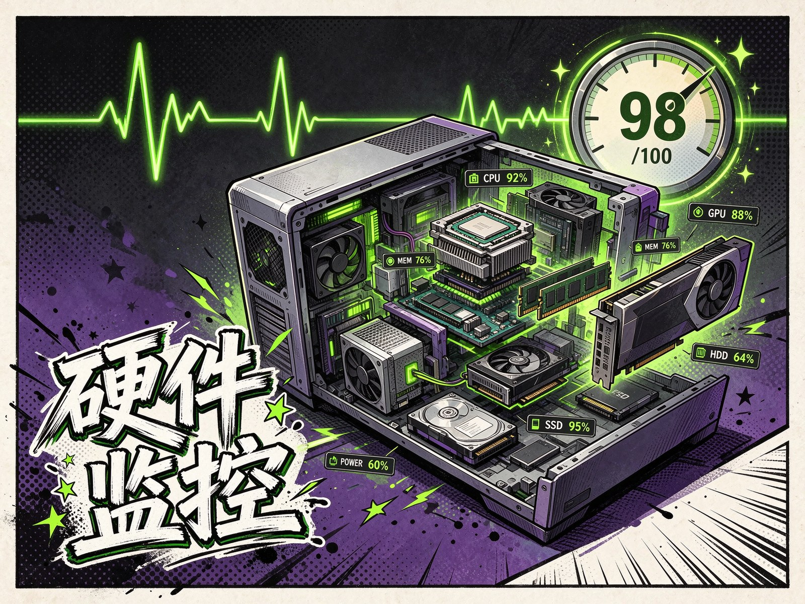

<p align="center"></p>

<h1 align="center">SysPulse</h1>

<p align="center">终端里的硬件监控台：CPU / GPU / 内存 / 磁盘 / 网络实时看，附 0–100 综合跑分</p>

<p align="center">
  <a href="LICENSE">MIT 许可</a>
</p>

## 简介

不用装臃肿的桌面监控软件：一个 Python 脚本在终端铺开六块面板，每 0.5 秒刷新一次硬件状态；想判断这台机器还够不够用，跑一次诊断就能拿到量化评分与瓶颈位置。

## 功能

- **实时仪表盘**：六面板同屏，0.5 秒刷新（Rich Live）
- **性能诊断**：CPU 单核 / 多核跑分 + 内存带宽 + 磁盘读写 → 0–100 综合评分
- **硬件详情**：CPU、GPU、内存、磁盘、网络的完整参数
- **快速 CPU 测试**：单独测单核与多核
- **负载配色**：绿色 <50%、黄色 50–80%、红色 >80%、深红 >95%
- **评分模型**：CPU 40% + 多核效率 30% + 内存 15% + 磁盘 15%
- **GPU 监控**：检测 `nvidia-smi`，显示使用率 / 显存 / 温度 / 功耗
- **多层回退**：WMI → `nvidia-smi` → psutil，尽量兼容不同机器

## 技术栈

Python 3.8+ · psutil 5.9+ · Rich 13+（Layout / Panel / Progress / Live）· WMI 1.5+ · `concurrent.futures` 多核跑分

## 快速开始

```bash
git clone https://github.com/aiyangdie/SysPulse.git
cd SysPulse
pip install -r requirements.txt
python main.py
```

Windows 也可双击 `运行.bat`。需要 Python 3.8+；GPU 面板需要 NVIDIA 显卡与驱动。

## 项目结构

```
main.py           入口与交互菜单
dashboard.py      实时监控仪表盘
collector.py      数据采集
hardware_info.py  硬件信息检测
diagnostic.py     诊断与跑分
screenshots/      界面截图
```

## 许可证

[MIT](LICENSE)
